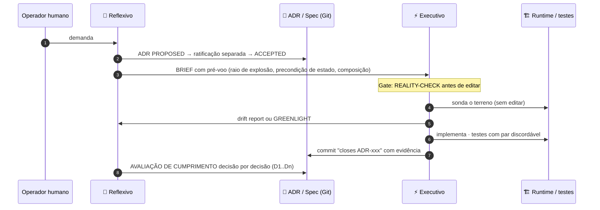

# 🧠⚡ EEEMIAD-dual

**A instanciação da EEE em dois agentes: um que decide, um que constrói**
*The two-agent instantiation of EEE: one that decides, one that builds*

[](LICENSE)
[](ROADMAP.md)
[](https://github.com/fuzaro/EEEMIAD)

> **Use o agente reflexivo para decidir o que construir. Use o agente executivo para construir o que foi decidido. ADRs e specs são a moeda de handoff entre eles.**

---

## 🌐 Idiomas / Languages

- 🇧🇷 [Dual-Agent Workflow (Português)](docs/pt/01-dual-agent-workflow.md)
- 🇺🇸 [Dual-Agent Workflow (English)](docs/en/01-dual-agent-workflow.md)
- 🇧🇷 [Delegação por nível de contexto, opcional (Português)](docs/pt/02-delegacao-por-nivel.md)
- 🇺🇸 [Delegation by context level, optional (English)](docs/en/02-tiered-delegation.md)

---

## O que é / What it is

A **EEE** ([EEEMIAD](https://github.com/fuzaro/EEEMIAD)) separa três papéis: *quem decide*, *quem constrói* e *quem verifica*. Este repositório descreve **uma forma específica de ocupar esses papéis com agentes de IA**:

| Papel EEE | Agente | Postura | Escreve em |
|---|---|---|---|
| Quem decide | 🧠 **Reflexivo** (sessões longas, planejamento, crítica) | Cética, uma decisão por vez, reflexão antes da ação | `Plan/`, ADRs, specs, briefs, avaliações |
| Quem constrói | ⚡ **Executivo** (sessões de código, diffs, testes) | Cirúrgica, guiada por ferramentas, mede antes de editar | código, testes, infraestrutura |
| Quem verifica | 🔍 Verificador cego (skill `eee-adversarial-verifier`, em EEEMIAD) ou o reflexivo em avaliação de cumprimento | Independente da implementação | suíte adversarial, ledger de avaliação |

A observação empírica que fundou o padrão: **o mesmo modelo** exibe posturas operacionais distintas conforme a sessão é instanciada (histórico acumulado, ferramentas disponíveis, padrão de uso, laço de feedback, modo plano × edição). Em vez de forçar um agente "médio em tudo", instrumenta-se a divisão, com **handoff explícito**.

## Os quatro mecanismos / The four mechanisms



1. **Brief com pré-voo** — o reflexivo entrega ao executivo um brief que marca âncoras como *"verificar, não confiar"* e carrega o bloco de raio de explosão. → [`templates/pt/brief-template.md`](templates/pt/brief-template.md)
2. **Reality-check como gate** — a sessão executiva **não começa editando**; o primeiro artefato prova que o terreno é o que o brief assume. → template em EEEMIAD (`reality-check-template.md`)
3. **Commit canônico de fechamento** — `<scope>: <subject> (closes ADR-xxx)` com comando e saída dos testes.
4. **Avaliação de cumprimento** — o reflexivo audita **cláusula por cláusula** da ADR com vereditos tipados (`CUMPRIDA`, `PARCIAL`, `NÃO-CUMPRIDA`, `NÃO-CERTIFICÁVEL`). Quem implementa não avalia o próprio trabalho. → [`templates/pt/evaluation-ledger-template.md`](templates/pt/evaluation-ledger-template.md)

## Opcional: delegação por nível de contexto / Optional: delegation by context level

Com um **sim** do operador na fase de perguntas, o trabalho fechado de um arco desce para modelos menores e é conferido contra o gate por um intermediário; decisões ficam no topo. Desligado por padrão. → [docs/pt/02](docs/pt/02-delegacao-por-nivel.md) · [docs/en/02](docs/en/02-tiered-delegation.md)

| Nível | Executa | Confere |
|---|---|---|
| Local (uma seção de spec, gate mecânico) | `eee-local-executor` · haiku | `eee-local-checker` · sonnet, contra o gate |
| Módulo (um charter e seu módulo) | `eee-module-builder` · sonnet | sessão de sistema, nos gates |
| Oráculo | `eee-oracle-writer` · modelo diferente do builder | negativo próprio |
| Sistema (decisões) | sessão principal | operador humano (`done@gate`) |

## Estrutura / Layout

```
EEEMIAD-dual/
├── docs/{pt,en}/01-dual-agent-workflow.md   o padrão completo
├── docs/{pt,en}/02-*                        delegação opcional por nível de contexto
├── agents/                                  eee-local-executor · eee-local-checker · eee-module-builder · eee-oracle-writer
├── templates/{pt,en}/
│   ├── brief-template.md                    handoff reflexivo → executivo, com pré-voo
│   └── evaluation-ledger-template.md        avaliação de cumprimento decisão por decisão
├── skills/
│   ├── eee-architect/                       skill do agente reflexivo (+ prompt de sessão)
│   ├── eee-executor/                        skill do agente executivo (+ prompt de brief)
│   ├── eee-task-router/                     opcional: pergunta, classifica e despacha pacotes
│   └── eee-gate-checker/                    opcional: conferência cega contra o gate
└── ROADMAP.md
```

## Relação com EEEMIAD / Relationship to EEEMIAD

Este repositório **depende** da EEE e não a repete. Hierarquia da verdade, pilha de DONE, fases, regras R1–R30, construção evolutiva (stubs, mocks, flags, arcos), M11 e anti-padrões estão em [EEEMIAD](https://github.com/fuzaro/EEEMIAD). Aqui ficam só os mecanismos de **divisão de papéis entre agentes**.

## Licença / License

[MIT](LICENSE).
