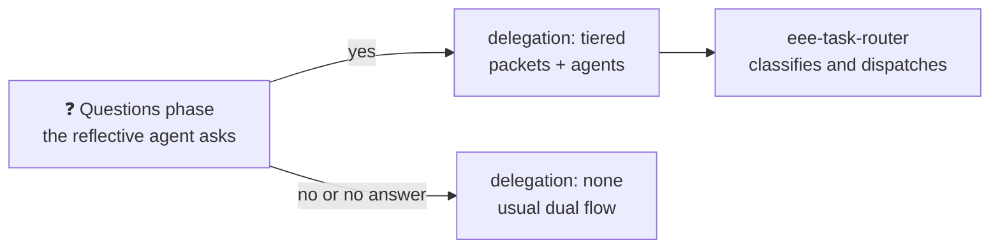
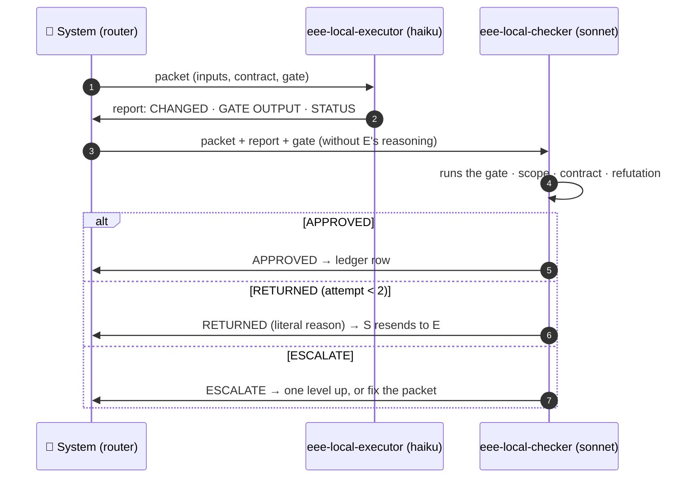

# 🧭 02 · Delegation by Context Level (optional)

*Smaller models execute what is closed; an intermediate one checks against the gate; decisions stay at the top*

> [!NOTE]
> **Optional and off by default.** It is used only after the operator's **yes** at the questions phase. The tool-neutral principle is in [EEEMIAD · 08 §6](https://github.com/fuzaro/EEEMIAD/blob/main/docs/en/08-application-guide.md#6-task-division-by-context-level-optional). This is the instantiation with Claude Code agents and models of different sizes.

---

## 1. Why it works with EEE

An arc's expensive work is **closing** it: a charter with property and refutation, the spec, the M11. After that, most of what remains is small, local and decided by a command. A smaller model executes that well; the risk is accepting the result unchecked. EEE already handles the risk: the verdict comes from the **gate**, and the checker does not read the executor's reasoning.

## 2. Activation (questions phase)



1. At the project's or arc's questions phase, the reflective agent asks the question of the [`eee-task-router`](../../skills/eee-task-router/SKILL.md) skill (step 0).
2. The answer goes into the charter: `delegation: tiered` or `delegation: none`.
3. On **yes**, copy the agents into the project:

```bash
mkdir -p .claude/agents && cp <path>/EEEMIAD-dual/agents/eee-*.md .claude/agents/
```

Without a yes, nothing in this document applies.

## 3. Who does what

| Level | Agent | Default model | Tools | Skill |
|---|---|---|---|---|
| Local · executes | [`eee-local-executor`](../../agents/eee-local-executor.md) | haiku | read, edit, run | task packet |
| Local · checks | [`eee-local-checker`](../../agents/eee-local-checker.md) | sonnet | read, run, **no edit** | [`eee-gate-checker`](../../skills/eee-gate-checker/SKILL.md) |
| Module · builds | [`eee-module-builder`](../../agents/eee-module-builder.md) | sonnet | all, within the module | [`eee-executor`](../../skills/eee-executor/SKILL.md) |
| Oracle | [`eee-oracle-writer`](../../agents/eee-oracle-writer.md) | **different from the builder** (haiku; opus for intricate specs) | read spec, write oracle | `eee-adversarial-verifier` (EEEMIAD) |
| System · decides | main session | the largest available | all | [`eee-architect`](../../skills/eee-architect/SKILL.md) + `eee-task-router` |
| `done@gate` | human operator | — | — | — |

Models are editable defaults in each agent's frontmatter. The rules do not change: the checker is not the executor, and oracle and builder never share a model.

## 4. Classifying a task (in order)

1. Needs a **decision** (contract, flag, ADR, cross-layer conflict, pre-flight answer) → **system**.
2. Reads **more than one module** → **module**.
3. **Has no mechanical gate** → cannot be local → **module**.
4. Everything else → **local**.

Local examples, each with a gate: generate the DDL from the spec (gate: parity checker); write the test for one M11 row (gate: it fails with the defect injected and passes without it); fill the evidence table from command output (gate: the commands re-run); translate a paragraph (gate: Markdown checker plus the intermediate's review against the original).

## 5. The loop of a local task



## 6. Measuring the saving

Each packet gets one row in the **Delegation record** section of the [evaluation ledger](../../templates/en/evaluation-ledger-template.md): level, executor model, checker model, gate on first attempt, attempts, escalation and cost when the tool reports it. At the arc's closure, compare the local level's escalation rate with the limit declared in the charter. Above the limit, the classification rule is wrong, not the model.

## 7. Anti-patterns

- **Re-reading checker:** the intermediate reads the output before running the gate, or reads the executor's reasoning. It becomes a second author, not a verifier.
- **Local task without a gate:** "review this text" with no deciding command. Classify it as module.
- **Decision packed downwards:** "choose the best approach" inside a local packet.
- **Oracle on the builder's model:** errors travel together and the pair stops disagreeing.
- **Delegation without the question:** enabling the division without the operator's yes, or without recording the answer in the charter.
