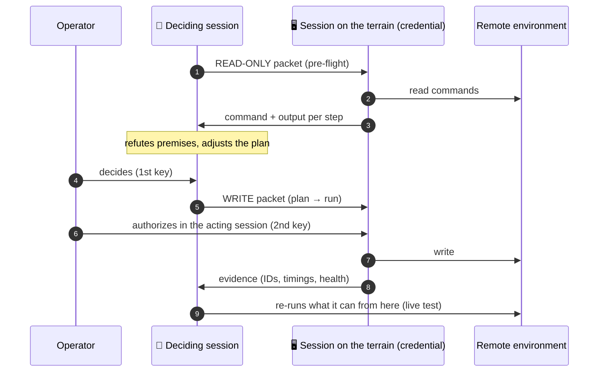

# 🔗 03 · Cross-Session Communication

*How a deciding session asks a session on the terrain for work, without the secret travelling and without trading evidence for trust*

> [!NOTE]
> The principle (six rules, tool-neutral) is in [EEEMIAD · 08 §7](https://github.com/fuzaro/EEEMIAD/blob/main/docs/en/08-application-guide.md#7-execution-across-sessions-optional). This is the concrete protocol for Claude Code sessions connected by **Remote Control**, learned in a real case: pre-flight, deploy and rollback of an application on a cluster whose credential existed only on another machine.

---

## 1. When to use it

Use a second session when the work needs something this session **does not have and should not have**: an orchestrator's credential, access to a network, a file on another machine. If the task can be done here, do it here: each cross-session round costs a message, a wait and an approval.

## 2. Connecting and finding the other session

1. In each session, enable Remote Control (`/remote-control`). Sessions of the same account can then see each other.
2. In the deciding session, list the peers (`ListAgents`). The other session appears by name, with its state (`idle`, `busy`, `offline`).
3. Give sessions stable names (the name is the address). A restarted session keeps its name but may lose its environment (§6).

## 3. The message is a closed packet

Use the [cross-session message template](../../templates/en/cross-session-message-template.md). The minimum:

- **A self-contained first line:** the recipient may see only it before opening. Say what it is and the nature of the action: *"READ-ONLY pre-flight of the cluster for the deploy of X"*.
- **What not to do**, explicitly: *"do not run job run, write nothing, print no secret"*.
- **Numbered steps**, each with the expected command.
- **Reply format:** command + output per step; long outputs summarized; secrets omitted.
- **Who to reply to:** the deciding session's name.

Send it all at once. A message cannot be undone.

## 4. Two keys to write

| Action in the remote environment | Key 1 (deciding session) | Key 2 (acting session) |
|---|---|---|
| Read (status, plan, validate, pull) | the decision to ask | the session's permission mode |
| Write (run, revert, stop, store a variable) | the operator's recorded decision | **the operator's authorization in that session** |

A request from another session is never authorization. If the acting session was prevented from doing something, the deciding session does **not** do it for it by another route: it goes back to the operator.

## 5. The secret does not travel

- The credential stays in the environment of the session that uses it. Messages carry commands and outputs.
- To store a secret value at the destination (e.g. a connection string in an orchestrator variable), the operator runs the command **in the acting session**, with `!`. Do not relay the value by message.
- Ask for confirmations that expose no value: *"tell me only whether the variable exists and which keys it has"*.

## 6. When the remote session restarts

A restarted session may come back without its environment variables, the credential included; commands start returning `403`. That is state outside the source, not a denied permission. The remote session must **not** look for the credential on its own: it asks the operator. To avoid depending on the session's memory, declare the source (an environment file with `600` permission, a vault) and load it in each command. Record **where** the source is in the project's operational state (`eee/state/environments/`, [doc 04](04-harness-neutral-installation.md)), never the value: the next session, of any tool, finds the path without asking again.

## 7. Wrong message? Correction protocol

1. Send **one** correction message, first line *"Correction of item N of the previous message"*.
2. State what is right, not only what was wrong, and restate the safety restriction (*"nothing runs without the token"*).
3. In the reply, check that the remote session recorded the correction **before** acting on the corrected item.

Corrective messages signal a packet that was not closed: record the occurrence in the arc's ledger.

## 8. Checking what comes back

- **Sent is not read.** No reply means no execution; the environment's state is that of the last evidence.
- **The peer's claim is information.** A conclusion from the remote session (*"the deploy will fail if the schema is not migrated"*) is checked against the spec before it becomes a decision.
- **Re-run from here** whatever is possible (live test against the public URL, health). Declare the R15 level of each line in the charter.
- **Record IDs and timings** (deployment, version, allocation, downtime): they become the cut-over evidence and a line in the project's evidence journal (`eee/log.md`).

## 9. Anti-patterns

- **Secret in the message:** relaying a password or token "because the operator already said it".
- **Write with one key:** the remote session acts only because another session asked.
- **Silence as consent:** taking the task as done without a reply.
- **Message adjusted in pieces:** several corrections in a row instead of one closed packet.
- **Permission laundering:** asking the peer for what this session was prevented from doing.
- **Trust in the report:** recording the peer's conclusion in the charter without command and output.
