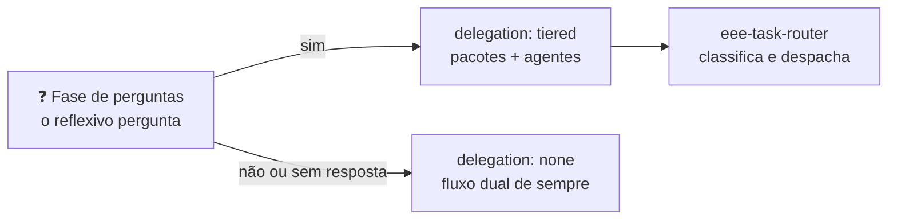
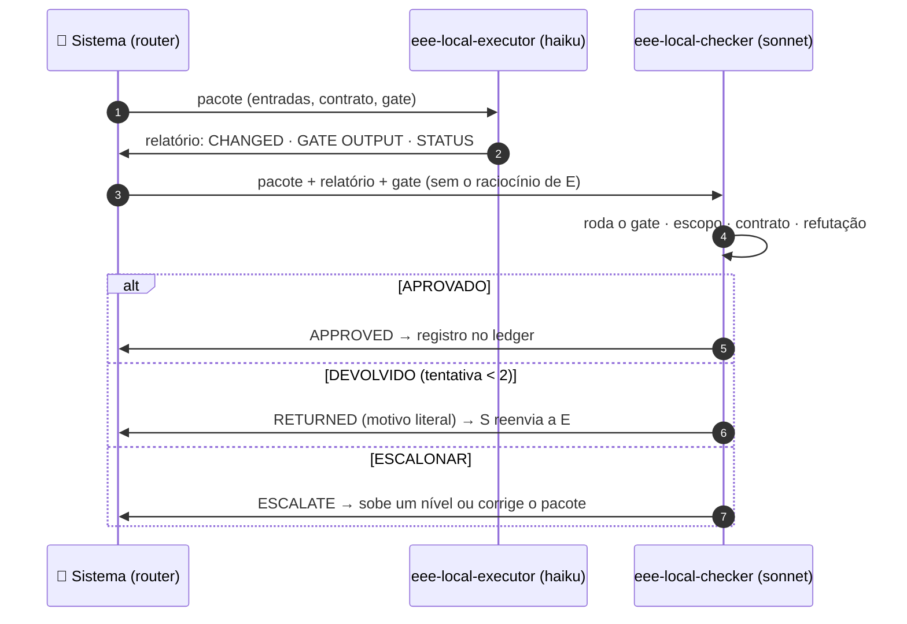

# 🧭 02 · Delegação por Nível de Contexto (opcional)

*Modelos menores executam o que está fechado; um intermediário confere contra o gate; decisões ficam no topo*

> [!NOTE]
> **Opcional e desligada por padrão.** Só entra em uso depois de um **sim** do operador na fase de perguntas. O princípio, neutro quanto a ferramenta, está em [EEEMIAD · 08 §6](https://github.com/fuzaro/EEEMIAD/blob/main/docs/pt/08-guia-de-aplicacao.md#6-divisão-de-tarefas-por-nível-de-contexto-opcional). Aqui está a instanciação com agentes do Claude Code e modelos de tamanhos diferentes.

---

## 1. Por que funciona com a EEE

O trabalho caro de um arco é **fechá-lo**: charter com propriedade e refutação, spec, M11. Depois disso, a maior parte do que resta é pequeno, local e decidido por um comando. Um modelo menor executa isso bem; o risco é aceitar o resultado sem conferir. A EEE já resolve o risco: o veredito vem do **gate**, e quem confere não lê o raciocínio de quem fez.

## 2. Ativação (fase de perguntas)



1. Na fase de perguntas do projeto ou do arco, o agente reflexivo faz a pergunta da skill [`eee-task-router`](../../skills/eee-task-router/SKILL.md) (passo 0).
2. A resposta vai para o charter: `delegation: tiered` ou `delegation: none`.
3. Com **sim**, copie os agentes para o projeto:

```bash
mkdir -p .claude/agents && cp <caminho>/EEEMIAD-dual/agents/eee-*.md .claude/agents/
```

Sem sim, nada deste documento se aplica.

## 3. Quem faz o quê

| Nível | Agente | Modelo padrão | Ferramentas | Skill |
|---|---|---|---|---|
| Local · executa | [`eee-local-executor`](../../agents/eee-local-executor.md) | haiku | ler, editar, rodar | pacote de tarefa |
| Local · confere | [`eee-local-checker`](../../agents/eee-local-checker.md) | sonnet | ler, rodar, **sem editar** | [`eee-gate-checker`](../../skills/eee-gate-checker/SKILL.md) |
| Módulo · constrói | [`eee-module-builder`](../../agents/eee-module-builder.md) | sonnet | todas no módulo | [`eee-executor`](../../skills/eee-executor/SKILL.md) |
| Oráculo | [`eee-oracle-writer`](../../agents/eee-oracle-writer.md) | **diferente do builder** (haiku; opus se a spec for intrincada) | ler spec, escrever oráculo | `eee-adversarial-verifier` (EEEMIAD) |
| Sistema · decide | sessão principal | o maior disponível | todas | [`eee-architect`](../../skills/eee-architect/SKILL.md) + `eee-task-router` |
| `done@gate` | operador humano | — | — | — |

Os modelos são padrões editáveis no frontmatter de cada agente. As regras não mudam: quem confere não é quem fez, e oráculo e builder nunca usam o mesmo modelo.

## 4. Classificação de uma tarefa (em ordem)

1. Exige **decisão** (contrato, flag, ADR, conflito entre camadas, resposta de pré-voo) → **sistema**.
2. Lê **mais de um módulo** → **módulo**.
3. **Não tem gate mecânico** → não pode ser local → **módulo**.
4. O resto → **local**.

Exemplos de tarefa local, todos com gate: gerar o DDL a partir da spec (gate: verificador de paridade); escrever o teste de uma linha da M11 (gate: o teste falha com o defeito injetado e passa sem ele); preencher a tabela de evidência a partir da saída de comandos (gate: os comandos reexecutados); traduzir um parágrafo (gate: verificador de Markdown e revisão do intermediário contra o original).

## 5. O laço de uma tarefa local



## 6. Medir a economia

Cada pacote ganha uma linha na seção **Registro de delegação** do [ledger de avaliação](../../templates/pt/evaluation-ledger-template.md): nível, modelo executor, modelo conferente, gate na primeira tentativa, tentativas, escalonamento e custo quando a ferramenta informar. No fechamento do arco, compare a taxa de escalonamento do nível local com o limite declarado no charter. Acima do limite, quem está errada é a regra de classificação, não o modelo.

## 7. Anti-padrões

- **Conferente que relê:** o intermediário lê a saída antes de rodar o gate, ou lê o raciocínio do executor. Vira segundo autor, não verificador.
- **Tarefa local sem gate:** "revise este texto" sem comando que decida. Classifique como módulo.
- **Decisão empacotada para baixo:** "escolha a melhor abordagem" dentro de um pacote local.
- **Oráculo do mesmo modelo do builder:** os erros andam juntos e o par deixa de discordar.
- **Delegação sem pergunta:** ligar a divisão sem o sim do operador, ou sem registrar a resposta no charter.
