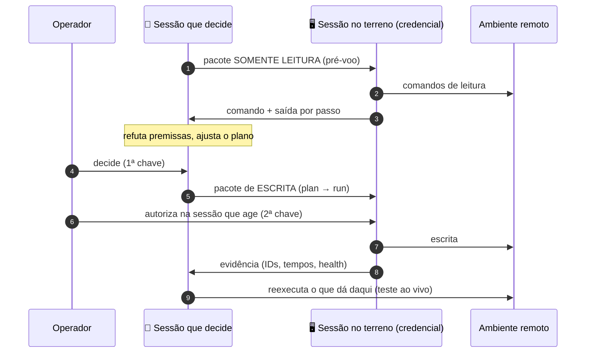

# 🔗 03 · Comunicação entre Sessões

*Como uma sessão que decide pede trabalho a outra que está no terreno, sem que o segredo viaje e sem trocar evidência por confiança*

> [!NOTE]
> O princípio (seis regras, neutras quanto a ferramenta) está em [EEEMIAD · 08 §7](https://github.com/fuzaro/EEEMIAD/blob/main/docs/pt/08-guia-de-aplicacao.md#7-execução-entre-sessões-opcional). Aqui está o protocolo concreto para sessões do Claude Code ligadas por **Remote Control**, aprendido num caso real: pré-voo, deploy e rollback de uma aplicação num cluster cuja credencial só existia noutra máquina.

---

## 1. Quando usar

Use uma segunda sessão quando o trabalho precisa de algo que esta sessão **não tem e não deve ter**: a credencial de um orquestrador, acesso a uma rede, um arquivo de outra máquina. Se a tarefa pode ser feita aqui, faça aqui: cada rodada entre sessões custa uma mensagem, uma espera e uma aprovação.

## 2. Ligar e encontrar a outra sessão

1. Em cada sessão, ative o Remote Control (`/remote-control`). As sessões da mesma conta passam a se enxergar.
2. Na sessão que decide, liste os pares (`ListAgents`). A outra sessão aparece pelo nome, com o estado (`idle`, `busy`, `offline`).
3. Dê nomes estáveis às sessões (o nome é o endereço). Uma sessão que reinicia mantém o nome, mas pode perder o ambiente (§6).

## 3. A mensagem é um pacote fechado

Use o [template de mensagem entre sessões](../../templates/pt/cross-session-message-template.md). O mínimo:

- **Primeira linha autoexplicativa:** o destinatário pode ver só ela antes de abrir. Diga o que é e a natureza da ação: *"Pré-voo SOMENTE LEITURA do cluster para o deploy de X"*.
- **O que não fazer**, explícito: *"não rode job run, não grave nada, não imprima segredos"*.
- **Passos numerados**, cada um com o comando esperado.
- **Formato da resposta:** comando + saída por passo; saídas longas resumidas; segredos omitidos.
- **Para quem responder:** o nome da sessão que decide.

Envie tudo de uma vez. Uma mensagem não se desfaz.

## 4. Duas chaves para escrever

| Ação no ambiente remoto | Chave 1 (sessão que decide) | Chave 2 (sessão que age) |
|---|---|---|
| Leitura (status, plan, validate, pull) | decisão de pedir | o modo de permissão da sessão |
| Escrita (run, revert, stop, gravar variável) | decisão do operador, registrada | **autorização do operador na própria sessão** |

Um pedido de outra sessão nunca é autorização. Se a sessão que age foi impedida de fazer algo, a sessão que decide **não** faz por ela por outro caminho: devolve ao operador.

## 5. O segredo não viaja

- A credencial fica no ambiente da sessão que a usa. As mensagens carregam comandos e saídas.
- Para gravar um valor secreto no destino (ex.: a string de conexão numa variável do orquestrador), o operador roda o comando **na sessão que age**, com `!`. Não repasse o valor por mensagem.
- Peça confirmações que não exponham valor: *"diga só se a variável existe e quais chaves tem"*.

## 6. Quando a sessão remota reinicia

Uma sessão reiniciada pode voltar sem as variáveis de ambiente, inclusive a credencial; os comandos passam a receber `403`. Isso é estado fora da fonte, não permissão negada. A sessão remota **não** deve procurar a credencial por conta própria: pede ao operador. Para não depender da memória da sessão, declare a fonte (arquivo de ambiente com permissão `600`, cofre) e carregue-a em cada comando. Registre **onde** está a fonte no estado operacional do projeto (`eee/state/environments/`, [doc 04](04-instalacao-neutra.md)), nunca o valor: a próxima sessão, de qualquer ferramenta, encontra o caminho sem perguntar de novo.

## 7. Errou a mensagem? Protocolo de correção

1. Envie **uma** mensagem de correção, com a primeira linha *"Correção do item N da mensagem anterior"*.
2. Diga o certo, não só o errado, e reafirme a restrição de segurança (*"nada roda sem o token"*).
3. Na resposta, confira que a sessão remota registrou a correção **antes** de agir no item corrigido.

Mensagens corretivas são sinal de pacote mal fechado: registre a ocorrência no ledger do arco.

## 8. Verificar o que volta

- **Enviado não é lido.** Sem resposta, não houve execução; o estado do ambiente é o da última evidência.
- **Afirmação do par é informação.** Uma conclusão da sessão remota (*"o deploy vai falhar se o schema não estiver migrado"*) é conferida contra a spec antes de virar decisão.
- **Reexecute daqui** o que for possível (teste ao vivo contra a URL pública, health). Declare o nível R15 de cada linha no charter.
- **Registre IDs e tempos** (deployment, versão, alocação, tempo fora do ar): eles viram a evidência de cut-over e uma linha no diário de evidências do projeto (`eee/log.md`).

## 9. Anti-padrões

- **Segredo na mensagem:** repassar senha ou token "porque o operador já tinha dito".
- **Escrita com uma chave:** a sessão remota age só porque outra sessão pediu.
- **Silêncio como aceite:** dar a tarefa por feita sem resposta.
- **Mensagem ajustada aos pedaços:** várias correções seguidas em vez de um pacote fechado.
- **Lavagem de permissão:** pedir ao par o que esta sessão foi impedida de fazer.
- **Confiança no relato:** registrar no charter a conclusão do par sem comando e saída.
